# Skills automáticas — guía de uso

Read in English: [automated-skills.md](automated-skills.md) · Volver al [README](../README.es.md)

La mayoría de las skills de los compendios del sistema ya traen sus reglas como datos, no solo como texto.
Cuando un personaje tiene una skill, el sistema aplica por sí solo lo que puede:

- **Skills Constant**: suman sus bonos a la hoja, escalados con el Skill Rank (SR), el Character Rank (CR) o
  los atributos. *Attack Mastery* da `+[SR×2]` de Attack Power, así que crece al subir el SR.
- **Tramos y requisitos**: los tramos "(SR2): …" se activan solos, y los Styles solo funcionan con el equipo
  correcto (*White Robe Style* deja de funcionar si te equipas un escudo).
- **Bonos a otras skills**: *White Robe Style* y *Reactive Mastery* suman a la curación de «Reactive Heal»;
  *Weapon Mastery: Blade* suma dados a los Weapon Attack hechos con un arma [Blade].
- **Cambios a otras skills**: costes de Hate menores, más alcance, notas extra en la tarjeta del chat.
- **Skills activas**: traen su Check y su Daño listos para tirar (`[(SR+3)D]` incluido) y aplican sus efectos
  al usarlas: stances, bonos durante el Main Process, Bad Status con su Rating en el objetivo.

Lo que no se puede automatizar (elecciones, movimiento, tablas, permisos para equipar algo, efectos que se
disparan con otros eventos…) sigue como texto en la descripción de la skill, como siempre.

Las capturas muestran Foundry en inglés; entre paréntesis va el nombre en inglés de cada botón o campo.

**Contenido**

1. [Jugadores: qué se ve en la hoja](#1-jugadores-qué-se-ve-en-la-hoja)
2. [Jugadores: usar las skills](#2-jugadores-usar-las-skills)
3. [GM: actualizar las skills que los personajes ya tienen](#3-gm-actualizar-las-skills-que-los-personajes-ya-tienen)
4. [Creadores: cómo se automatiza una skill](#4-creadores-cómo-se-automatiza-una-skill)
5. [Referencia](#5-referencia)
6. [Límites y preguntas frecuentes](#6-límites-y-preguntas-frecuentes)

---

## 1. Jugadores: qué se ve en la hoja

### Los efectos de tus skills

Abre la hoja del personaje, **Stats → Effects**. Cada skill Constant aparece con un resumen de una línea de lo
que hace, y el valor actual entre paréntesis:

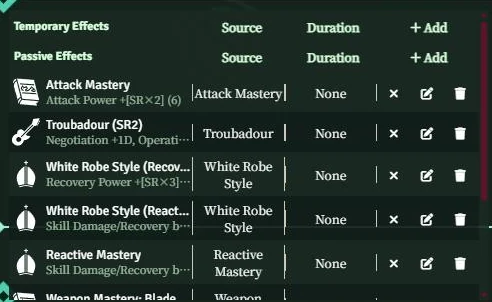

- `Attack Power +[SR×2] (6)`: *Attack Mastery* con SR 3 da +6. Si subes el SR, el número se actualiza.
- `Negotiation +1D, Operation +1D`: el tramo SR2 de *Troubadour*.
- `Skill Damage/Recovery bonus (dice) +[SR]D (2D) → [Weapon Attack], weapon [Blade]`: un bono que solo vale
  para algunas tiradas (ver la [sección 2](#2-jugadores-usar-las-skills)).

No tienes que hacer nada: los bonos ya están sumados en los atributos, checks y valores de combate de la hoja.

### "Condición no cumplida" (Condition Not Met)

Cuando no se cumple un requisito de una skill, su efecto pasa a **Condición no cumplida**, con el motivo en
rojo:

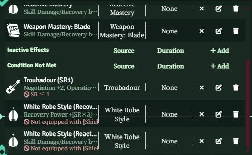

Aquí el personaje tiene *Troubadour* con SR 2, así que el tramo SR1 queda apagado (`SR ≤ 1`); y se equipó un
Buckler, así que *White Robe Style* deja de funcionar (`Not equipped with [Shield]`). Al desequipar el escudo,
los dos efectos de White Robe vuelven a funcionar en el acto.

Las condiciones que dependen del combate ([Hate Top], [Hate Under], primera ronda, Pre-Action, [Standby], tener
un estado) se vuelven a comprobar solas a medida que avanza el combate. Hate Top / Under se calcula con el Hate
de los personajes del combate en curso.

## 2. Jugadores: usar las skills

### Tiradas con bonos de otras skills

Tira la skill como siempre (los botones **Check** / **Damage** de su tarjeta de chat, o desde su hoja). Los
bonos de tus otras skills que corresponden a esa tirada se suman solos, y la tarjeta los lista bajo el
resultado:

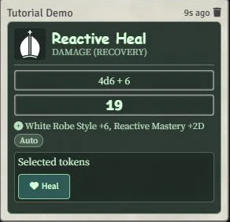

*Reactive Heal* cura 2D; con *Reactive Mastery* SR 2 (+[SR]D) y *White Robe Style* SR 2 (+[SR×3]) la tirada
queda `4d6 + 6`, y la tarjeta dice de dónde sale cada parte.

Un bono puede depender de la skill que se tira, de sus tags, del arma de la mano principal, de los tags del
objetivo, de un estado tuyo o del tipo de daño. Algunos son **exclusivos**: a un mismo ataque solo se le
aplica el *Weapon Mastery* mayor, aunque conozcas varios.

### Skills que aplican efectos al usarse

Haz clic en una skill de la hoja para mandar su tarjeta al chat. Si la skill tiene efectos "al usar" (stances,
"During this Main Process…", estados para el objetivo), el sistema los aplica:

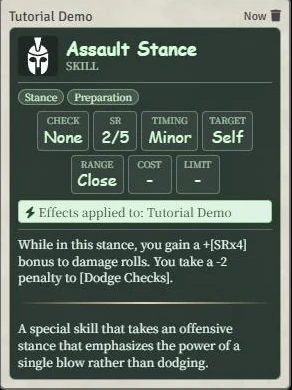

- **Target: Self** → el efecto va a ti en el acto ("Effects applied to: …").
- **Otros objetivos** → va a los tokens que tengas **marcados como objetivo** (pasa el ratón sobre el token y
  pulsa T) al usarla. Si no tenías objetivos, la tarjeta muestra el botón **Aplicar efectos** (Apply effects):
  marca los tokens y púlsalo.
- **Skills con check enfrentado** (vs Evasion / Resistance) → no se aplica nada hasta ver si acierta: tira, y
  luego pulsa **Aplicar efectos** con los objetivos alcanzados marcados.

Las fórmulas se resuelven con **tus** valores en ese momento: *Pain Needle* da al objetivo `[Decay]` con Rating
`[INT mod × 2]`, calculado con el INT de quien la usa.

El efecto aplicado aparece en **Efectos temporales** (Temporary Effects) de la hoja, con su ícono en el token, y
dura lo que dice la skill: hasta el final del proceso, de la ronda o de la escena (ver [Duración](#duración)). Las skills Harmony, Servant Summon y Enchantment respetan su límite de usos activos
(1, 1 y 2): si lo superas, un diálogo pregunta cuál terminar.

## 3. GM: actualizar las skills que los personajes ya tienen

Una skill en un personaje es una **copia** de la entrada del compendio. Cuando el compendio mejora (efectos,
condiciones, Check/Daño nuevos), las copias que los personajes ya tenían **no cambian solas**. Las skills que
se arrastren del compendio desde ahora ya vienen completas; para las antiguas hay una herramienta.

### Dónde está

- **Un personaje**: menú ⋮ de la hoja del personaje → **Actualizar skills desde el compendio** (Refresh skills
  from the compendium).

  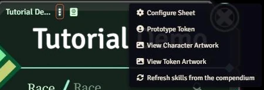

- **Todos los personajes del mundo**: **Game Settings → Log Horizon TRPG → Actualizar skills de los
  personajes** (Refresh characters' skills).

  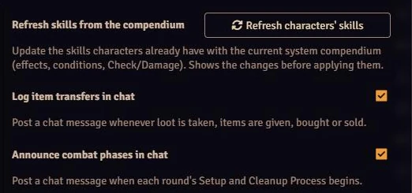

Solo la ve un GM.

### Qué hace

La herramienta busca cada skill en los compendios del sistema y **muestra los cambios antes de tocar nada**:

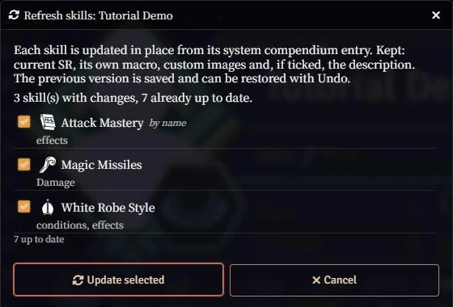

- Cada línea es una skill con diferencias y, debajo, lo que cambiaría (efectos, condiciones, Daño…).
  Desmarca las que no quieras actualizar.
- **por nombre** (by name): la skill no estaba enlazada al compendio del sistema (por ejemplo, venía de un
  compendio del mundo), así que se encontró por su nombre. Desde ahora quedará enlazada.
- Si dos skills del sistema comparten el nombre, te deja elegir; la de descripción más parecida aparece
  primero.
- Las skills que no existen en los compendios del sistema (propias, renombradas) aparecen como **Sin
  equivalente en el compendio** y nunca se tocan.

Al pulsar **Actualizar las marcadas** (Update selected), cada skill se actualiza en su sitio (el mismo item, en
el mismo lugar de la hoja):

| Se reemplaza con el compendio | Se conserva |
|---|---|
| Los datos de reglas: tags, timing, alcance, objetivo, coste, límite, Check, Daño, condiciones, SR máximo | El **SR** actual (se baja si supera el nuevo máximo) |
| **Todos** los efectos de la skill | Su macro propia |
| La descripción (salvo que marques **Conservar la descripción actual**) | Una imagen personalizada |

> **Ojo**: los efectos que añadiste o editaste a mano en la skill de un personaje se reemplazan por los del
> compendio. El diálogo avisa de los efectos que estaban desactivados a mano. Las skills propias nunca se tocan.

### Deshacer

La versión anterior de cada skill queda guardada. Abre de nuevo la herramienta y pulsa **Deshacer última
actualización** (Undo last refresh):

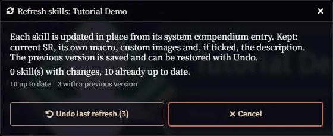

Aun así, haz una copia de seguridad del mundo antes de actualizar todos los personajes de una vez.

## 4. Creadores: cómo se automatiza una skill

Esta sección es para el GM que quiera automatizar una skill propia o corregir una del compendio. Todo se hace
desde la hoja de la skill y el editor de efectos activos; no hace falta código.

### Las piezas de una skill automática

| Pieza | Dónde | Para qué sirve |
|---|---|---|
| **Check / Daño** | Hoja de la skill, arriba | Las tiradas propias de la skill. Aceptan fórmulas. |
| **Condiciones de la skill** | Hoja de la skill → pestaña Effects | Requisitos de toda la skill ("This skill only produces an effect when…"). |
| **Efectos** | Hoja de la skill → pestaña Effects | Lo que cambia la skill. Pasivos (Constant) o aplicados al usarla. |
| **Condiciones de un efecto** | Editor del efecto → Conditions | Requisitos de un solo efecto (tramos "(SR2): …"). |
| **Filtro de skills** | Editor del efecto → Conditions | A qué tiradas / skills afecta un bono a otras skills. |
| **Estado LH** | Editor del efecto → LH Status | Un estado de Log Horizon que da el efecto (con Rating / Tag). |
| **Duración (LH)** | Editor del efecto → Duration | Cuánto dura un efecto aplicado al usar. |

### Check y Daño

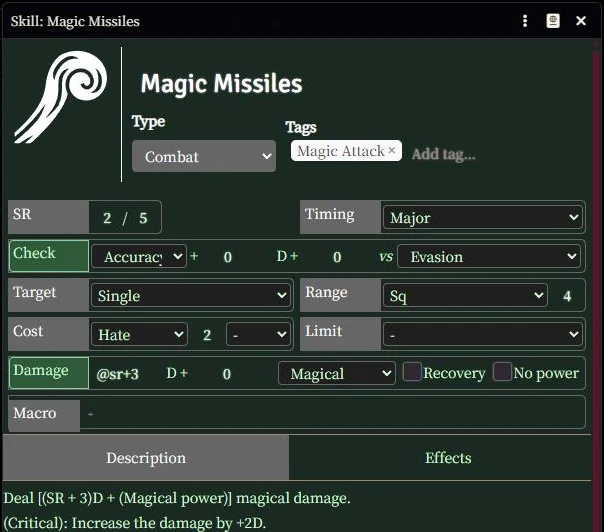

*Magic Missiles*: "[(SR+3)D + Magic Power] magical damage" → dados de Daño `@sr+3`, tipo **Mágico**, vs
**Evasion**.

- Los dados y el modificador aceptan un número o una fórmula: `@sr`, `@sr+3`, `@sr*2`, `@sr*5`, `@cr`…
  El campo de dados también sugiere valores habituales.
- **Físico** suma el Attack Power y **Mágico** el Magic Power. **Recuperación** (Recovery) marca una curación
  (suma el Recovery Power). **Sin poder** (No power) no suma nada: úsalo cuando el texto da su propio total
  ("[4D + Magic Power] physical damage" → Sin poder, modificador `@magic`).
- También hay tipos de daño **Penetrante** y **Directo**.

### Efectos pasivos (skills Constant)

En la pestaña **Effects** de la skill, añade un efecto (**+ Add**) y ábrelo. En **Details**, **Apply Effect to
Actor** tiene que estar marcado: el efecto funciona mientras el personaje tenga la skill.

En **Changes**, el campo **Attribute Key** es un selector: escribe parte del nombre (`defense`, `athletics`,
`hp`…) y elige un destino de la lista. Solo se ofrecen campos que de verdad funcionan.

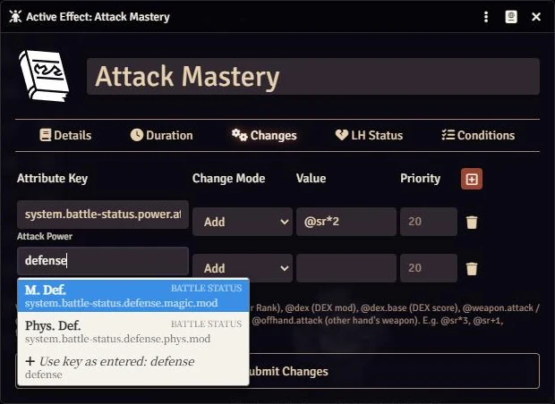

Usa el modo **Add** y escribe el valor. El valor puede ser una **fórmula** (la pista bajo la tabla recuerda las
variables):

| Texto de la skill | Destino | Valor |
|---|---|---|
| +[SR×2] [Attack Power] | Poder de Ataque | `@sr*2` |
| +[DEX mod] a [Initiative] | Iniciativa | `@dex` |
| +16 [Max HP] | HP máx. | `16` |
| +1D a [Athletics] | Atletismo (dados) | `1` |
| [Attack Power] pasa a ser [Attack Power del arma × 2] | Poder de Ataque | `@weapon.attack` (la base ya es la del arma) |

Los resultados se redondean hacia abajo, como en las reglas. La lista completa de variables está en la
[referencia](#variables-de-las-fórmulas).

### Condiciones

**De toda la skill** — el "This skill only produces an effect when…" de los Styles. En la pestaña Effects de la
skill, **Condiciones → +**. Afectan a todos sus efectos. *White Robe Style* = sin equipar [Heavy Armor] y sin
equipar [Shield]:

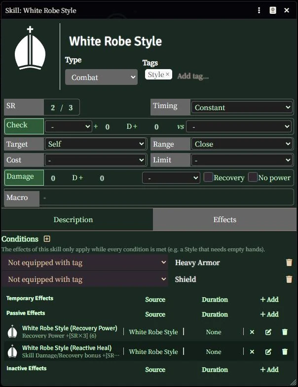

**De un solo efecto** — tramos y situaciones. En el editor del efecto, pestaña **Conditions**. El tramo SR2 de
*Troubadour*:

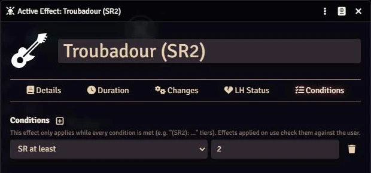

Cuando un tramo **suma** algo: un efecto para la base y otro con `SR mínimo 2`. Cuando **reemplaza** el valor
anterior ("the bonus becomes +1D instead"): dos efectos, uno con `SR máximo 1` y otro con `SR mínimo 2`. Igual
con el CR (`CR mínimo 11`, `CR máximo 10`…).

Tienen que cumplirse todas las condiciones de una lista. Los tipos disponibles están en la
[referencia](#tipos-de-condición).

### Bonos a otras skills (filtro de skills)

Para textos como "+[SR×3] to the HP recovered when using «Reactive Heal»" o "+[(SR)D] to [Weapon Attack] damage
rolls with a [Blade] weapon":

1. En **Changes**, elige un destino del grupo **Tiradas de skills** (Skill Rolls):
   - **Bono al Check de skills** / **(dados)** → el Check (Hit / Accuracy incluido) de las skills filtradas.
   - **Bono al Daño/Curación de skills** / **(dados)** → su daño o su curación.
   - **Coste de Hate de skills** → Add `-1` / `-@sr`, u Override `0` para "reduce el coste a 0".
   - **Rango de skills (Sq)** → `1` = +1 Sq.
   - **Nota en skills** → un texto que se muestra con la skill (p. ej. `Ignores [Cancel: Cold]`).

   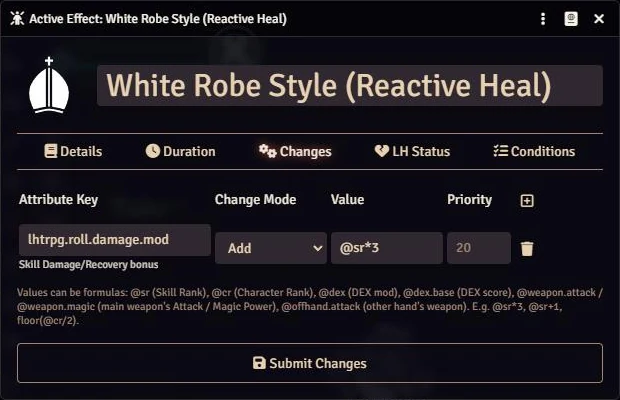

2. En **Conditions → Filtro de skills** (Skill filter), indica a qué skills se aplica:

   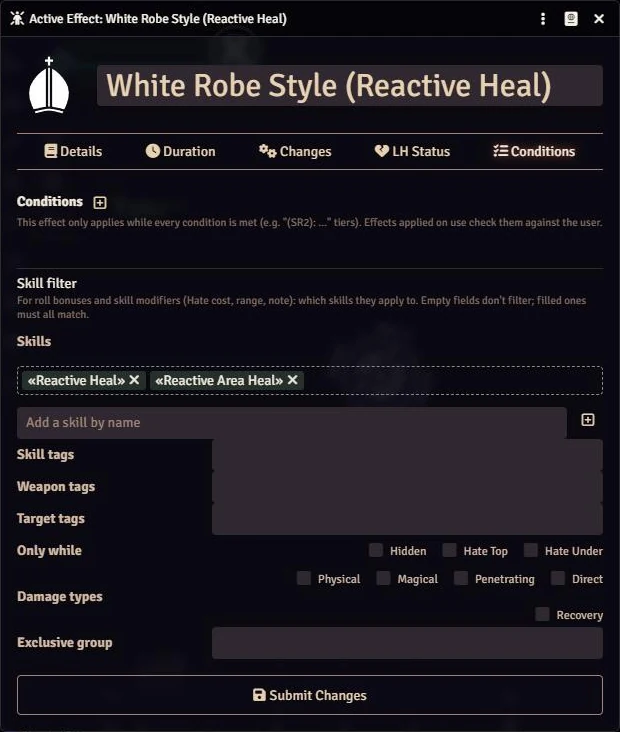

   | Campo | Ejemplo | Se aplica cuando… |
   |---|---|---|
   | Skills | «Reactive Heal» | la skill que se tira es una de estas. Arrastra skills desde un compendio, o añádelas por nombre. |
   | Tags de la skill | `Weapon Attack` | la skill tiene uno de estos tags |
   | Tags del arma | `Blade` | el arma de la mano principal tiene uno de estos tags |
   | Tags del objetivo | `Construct` | un objetivo tiene uno de estos tags |
   | Solo mientras | Hidden | tienes ese estado ([Hidden], [Hate Top], [Hate Under]) |
   | Tipos de daño | Físico / Curación | la skill hace ese tipo de daño, o cura |
   | Grupo exclusivo | `Weapon Mastery` | en una tirada solo cuenta el bono mayor del grupo |

   Los campos vacíos no filtran; los rellenos deben cumplirse **todos**. Con el filtro entero vacío, el bono vale
   para todas las tiradas de skills.

El coste de Hate, el rango y las notas modificados así se muestran en la hoja de la skill y en su tarjeta de chat
(valor anterior tachado → valor nuevo, con el origen en el tooltip). El coste de Hate no se descuenta solo.

### Efectos que se aplican al usar la skill

Para skills activas ("During this Main Process…", stances, "The target takes [Rigor]"):

1. En **Details**, **desmarca Apply Effect to Actor**. Eso convierte el efecto en "al usar": no se aplica a quien
   tiene la skill, se copia al objetivo cuando se usa (ver la [sección 2](#skills-que-aplican-efectos-al-usarse)).
2. En **Changes**, los bonos como siempre (también pueden ser bonos de tirada con filtro: *Pinpoint* = Bono al
   Daño/Curación de skills `@sr*3`, filtro tags de la skill `Weapon Attack`).
3. En **Duration**, elige la **Duración (LH)**.

#### Duración

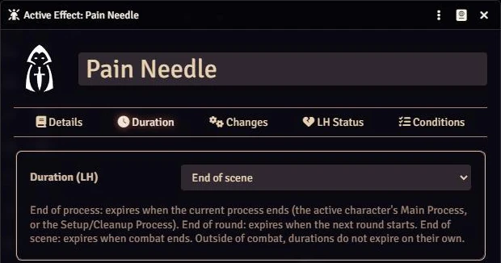

| Texto de la skill | Duración (LH) |
|---|---|
| "During this Main Process", "for this check", bonos con timing Before Check / Damage Roll | Fin del proceso |
| "until the end of the round" | Fin de ronda |
| "until the end of the scene", stances, "Treat this effect as a Combat Status" | Fin de escena |

Fuera de combate las duraciones no caducan solas: borra el efecto a mano cuando termine. Un efecto aplicado al
usar sin duración termina con el combate (fin de escena).

#### Estados con Rating

Para dar un estado de Log Horizon ("The target takes [Decay: (SR×5)]", "gains [Regen: 10]"), usa la pestaña
**LH Status**: elige el estado y, si lo tiene, su **Rating** (número o fórmula) y su **Tag** (para [Weakness] y
[Cancel]). Un efecto = un estado.

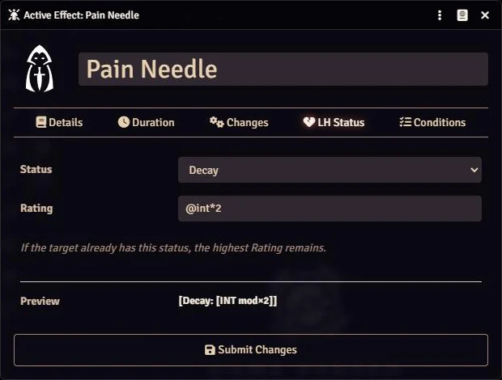

La fórmula se resuelve con los valores de quien usa la skill, en ese momento. Si el objetivo ya tiene el estado,
queda el Rating mayor.

#### Condiciones de un efecto que se aplica al usar

Se comprueban con **quien usa** la skill en el momento de usarla, y la copia las pierde. *Divine Might* (+2D,
CR11: +4D, CR21: +6D) = tres efectos con `CR máximo 10` / `CR mínimo 11 + CR máximo 20` / `CR mínimo 21`.

## 5. Referencia

### Variables de las fórmulas

| Variable | Valor |
|---|---|
| `@sr`, `@srMax` | SR / SR máximo de la skill que da el efecto |
| `@cr` | Character Rank (monstruos: su Rank) |
| `@str`, `@dex`, `@pow`, `@int` | **Modificador** del atributo (igual que `@str.mod`…) |
| `@str.base`, `@dex.base`… | **Valor** del atributo |
| `@weapon.attack`, `@weapon.magic` | Attack / Magic Power del arma de la mano principal (0 sin arma) |
| `@offhand.attack`, `@offhand.magic` | Lo mismo para el arma de la otra mano (un escudo cuenta como nada) |
| `@attack`, `@magic`, `@recovery` | Attack / Magic / Recovery Power. **Solo** en tiradas de skills, bonos de tirada y efectos aplicados al usar |

Funciones: `floor()`, `ceil()`, `max()`, `min()`. Los resultados siempre se redondean hacia abajo.
Ejemplos: `@sr*3`, `@sr+1`, `floor(@cr/2)`, `@dex*2`, `@int*@sr`.

### Tipos de condición

| Tipo | Valor | Texto que representa |
|---|---|---|
| SR mínimo / SR máximo | número | tramos "(SR2): …" |
| CR mínimo / CR máximo | número | tramos "(CR11): …" |
| Equipado con tag | tag | "while equipped with a [Bow] / [Shield] / [Two-Handed] weapon" |
| Sin equipar tag | tag | "when you are not equipped with [Heavy Armor]" |
| Ambas manos vacías | — | "nothing equipped to your [Hand Slots]" |
| Al menos una mano vacía | — | "at least one empty [Hand Slot]" |
| Solo un arma en mano | tag (opcional) | "a single [One-Handed] weapon" |
| Dos armas en mano | tag (opcional) | "two [One-Handed] weapons" |
| Sin armadura | — | "your [Armor Slot] is empty" |
| Tiene el estado / No tiene el estado | estado | "while [Hidden]" |
| Hate Top / Hate Under | — | "while [Hate Top]" |
| En combate | — | — |
| Primera ronda del combate | — | "during the first round of a scene" |
| Pre-Action | — | "in [Pre-Action]" (no ha actuado esta ronda) |
| Declaró Standby esta ronda | — | "the round you declared [Standby]" |

### Destinos más usados

| Texto | Destino en el selector |
|---|---|
| STR / DEX / POW / INT (base incluida) | Atributos → STR… |
| [Max HP], [Starting Fate Points], [Inventory Slots] | Recursos → HP máx. / Destino máx. / Espacio |
| +N / +ND a un check (Hit Check = Accuracy, Dodge = Evasion, Analyze = Analysis…) | Tiradas / Dados de tirada |
| [Attack / Magic / Recovery Power], [Physical / Magic Defense], [Initiative], [Speed] | Combate |
| Bonos y modificadores para otras skills | Tiradas de skills |

## 6. Límites y preguntas frecuentes

**¿Qué queda como texto?** Las elecciones ("choose one skill", "select [Flame] or [Cold]"), las tablas de
agotamiento y de búsqueda, el movimiento y los teletransportes, recibir el daño de otro personaje, los permisos
para equipar algo o los límites de Item Rank, las inmunidades, la visión, y los efectos que se disparan con
otros eventos ("when you apply a Bad Status…"). Si solo una parte de una skill se puede automatizar, esa parte
lo está y el resto sigue en la descripción.

**Subí el SR de una skill y no cambió nada.** Revisa que su efecto no esté en **Condición no cumplida** o en
**Efectos inactivos**. Si la skill es antigua (de antes de esta actualización), actualízala con la herramienta
del GM ([sección 3](#3-gm-actualizar-las-skills-que-los-personajes-ya-tienen)).

**Un bono no aparece en la tarjeta.** Mira el filtro de skills del efecto: todos los campos rellenos tienen que
cumplirse (la skill, sus tags, el arma de la mano principal, los objetivos…). Los bonos exclusivos del mismo
grupo no se suman.

**¿Los bonos funcionan en monstruos?** Los efectos y las fórmulas, sí (`@cr` = el Rank del monstruo). Las
condiciones Hate Top / Under y la herramienta de actualización son solo para personajes.

**Edité una skill del compendio y mis personajes no se enteraron.** Es lo esperado: los personajes tienen
copias. Usa la herramienta de actualización, o vuelve a arrastrar la skill al personaje.

**Algo está mal automatizado.** Abre un [issue](https://github.com/DeadlyPoisonK/LHTTRPG/issues) con el nombre
de la skill y lo que esperabas.
